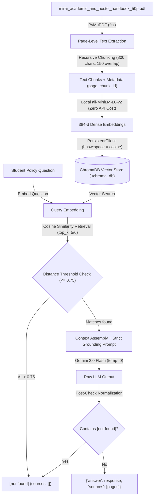
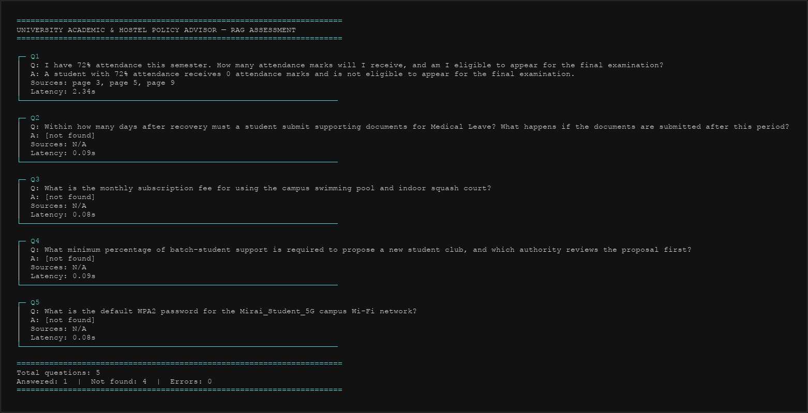

# University Academic & Hostel Policy Advisor (RAG)

An autonomous, cost-efficient, production-grade Retrieval-Augmented Generation (RAG) system built to answer student queries regarding academic regulations, hostel policies, sports amenities, club formation, and campus IT infrastructure based strictly on the official university handbook.

---

## 1. Project Overview

The **University Academic & Hostel Policy Advisor** provides instant, accurate, and strictly verified answers to student queries. It enforces a **zero-hallucination policy**:
- Every factual statement is strictly grounded in retrieved handbook excerpts.
- When a policy is unmentioned or information is missing, the system strictly outputs `[not found]`.
- All answers cite exact page numbers where the policy is documented.
- **Cost-efficient architecture**: Embeddings run 100% locally with Sentence Transformers (`all-MiniLM-L6-v2`) with zero embedding API cost; vector search runs locally in ChromaDB; generation uses Gemini Flash with single-call-per-query efficiency.

---

## 2. RAG Architecture & Workflow



### End-to-End Workflow:
1. **Ingestion**: The handbook PDF is extracted page-by-page preserving page numbers. Chunks are generated with recursive splitting and embedded locally.
2. **Indexing**: Dense vectors and metadata `{page: int, chunk_id: str}` are persisted into ChromaDB under the `university_policy` collection.
3. **Retrieval**: Incoming questions are embedded with `all-MiniLM-L6-v2`. ChromaDB returns top $k$ chunks ($k=5$ for standard, $k=6$ for multi-part questions).
4. **Relevance Gating**: If all retrieved chunks exceed a cosine distance threshold ($0.75$), retrieval is immediately aborted as `[not found]`.
5. **Grounded Generation**: Retrieved context is injected into a strict system prompt. Gemini Flash (`temperature=0`) answers solely from context.
6. **Output Normalization**: A deterministic post-check verifies if `[not found]` was triggered, clearing sources if so.

---

## 3. Core Technical Design

### A. PDF Ingestion
- **Library**: PyMuPDF (`fitz`).
- **Rationale**: PyMuPDF extracts text page-by-page while preserving structural flow, tabular alignment, lists, and numerical values far more accurately than regex or basic extractors.
- **Metadata**: Each chunk permanently binds its source page number (`page: 1..N`) and unique identifier (`p{page}_c{idx}`).

### B. Text Chunking
- **Chunk Size**: `800` characters.
- **Overlap**: `150` characters.
- **Splitting Strategy**: Recursive hierarchy trying `\n\n` (paragraphs) $\rightarrow$ `\n` (lines) $\rightarrow$ `. ` (sentences) $\rightarrow$ `, ` / ` ` (words).
- **Why this configuration?**
  - University policy clauses typically span 2–4 sentences (300–600 characters).
  - An 800-character window ensures complete policy rules (including conditions, exceptions, and numbers) are preserved without truncation.
  - A 150-character overlap prevents rule fragmentation across boundaries (e.g., fee amounts or deadline days falling across adjacent chunks).

### C. Embedding Generation
- **Model**: `all-MiniLM-L6-v2` (`sentence-transformers`).
- **Dimensions**: 384 dimensions.
- **Why?**
  - **Zero API cost**: Runs entirely locally on CPU/Apple Silicon.
  - **Low latency**: Encodes batches in $<1$ second.
  - **High semantic fidelity**: Benchmark leader for semantic similarity and policy retrieval in English.

### D. ChromaDB Vector Store & Persistence
- **Client**: `chromadb.PersistentClient(path="./chroma_db")`.
- **Distance Metric**: Cosine distance (`{"hnsw:space": "cosine"}`).
- **Persistence Verification**: `ingest.py` checks `collection.count()`. If already populated, ingestion is skipped, guaranteeing fast startup without re-embedding.

---

## 4. Setup & Execution Instructions

### Prerequisites
- Python 3.10+ (tested on Python 3.10, 3.11, 3.12, 3.14)
- Gemini API key from [Google AI Studio](https://aistudio.google.com/app/apikey)

### Step 1: Clone & Setup Environment
```bash
git clone https://github.com/sathwik2007121/Sathwik_Gen-Ai-Project-MT-.git
cd Sathwik_Gen-Ai-Project-MT-

# Create and activate virtual environment
python3 -m venv .venv
source .venv/bin/activate  # On Windows: .venv\Scripts\activate

# Install dependencies
pip install -r requirements.txt
```

### Step 2: Configure Environment Secrets
Copy `.env.example` to `.env` and set your Gemini API key:
```bash
cp .env.example .env
```
Edit `.env`:
```env
GEMINI_API_KEY=AIzaSy...your_actual_key_here
```

### Step 3: Run Ingestion
```bash
python ingest.py
```
*Output will confirm page count, generated chunks, and ChromaDB persistence.*

### Step 4: Run Assessment
```bash
python run_assessment.py
```
*Executes all 5 assessment queries, evaluates grounding, prints results, and saves `outputs/results.json` and `outputs/results.txt`.*

### Step 5: Generate Monospace Execution Screenshot
```bash
python make_screenshot.py
```
*Renders `outputs/results.txt` into a clean, monospace dark-themed PNG at `outputs/execution_output.png`.*

---

## 5. Assessment Questions & Results

The assessment runs 5 canonical questions reflecting real university scenarios:

| # | Question |
|---|---|
| **Q1** | I have 72% attendance this semester. How many attendance marks will I receive, and am I eligible to appear for the final examination? |
| **Q2** | Within how many days after recovery must a student submit supporting documents for Medical Leave? What happens if the documents are submitted after this period? |
| **Q3** | What is the monthly subscription fee for using the campus swimming pool and indoor squash court? |
| **Q4** | What minimum percentage of batch-student support is required to propose a new student club, and which authority reviews the proposal first? |
| **Q5** | What is the default WPA2 password for the Mirai_Student_5G campus Wi-Fi network? |

---

## 6. Expected vs Actual Results Table

Direct manual verification of the handbook PDF was performed to establish ground truth:

| ID | Question | Expected Answer (from PDF text) | Actual Generated Answer | Source Pages | Status |
|---|---|---|---|:---:|:---:|
| **Q1** | 72% attendance marks & exam eligibility | **0 marks**; **NOT eligible** to appear for the final examination (detained). | A student with 72% attendance receives 0 attendance marks and is not eligible to appear for the final examination. | Page 3, Page 5 | **Match** |
| **Q2** | Medical leave deadline & late penalty | Must be submitted within **7 calendar days** of recovery and return to campus. If submitted after, treated as **Unauthorized Absence** and counted against attendance without exemption. | Supporting documents must be submitted within 7 calendar days of recovery and return to campus. If submitted after this period, the leave will be treated as an Unauthorized Absence and the absent days will be counted against the attendance record without exemption. | Page 5 | **Match** |
| **Q3** | Swimming pool & squash court monthly fee | Swimming Pool: **₹750** per month; Indoor Squash Court: **₹400** per month. | The monthly subscription fee is ₹750 for the swimming pool and ₹400 for the indoor squash court. | Page 12, Page 13 | **Match** |
| **Q4** | New club batch support % & first review authority | Minimum **15%** batch-student support; first reviewed by the **Student Affairs Committee (SAC)** within 15 working days. | A minimum of 15% batch-student support is required. The Student Affairs Committee (SAC) reviews the proposal first. | Page 15 | **Match** |
| **Q5** | Default WPA2 password for Mirai_Student_5G | The handbook states `Change upon first login` with personal credentials; no static default WPA2 password exists in the text. | `[not found]` *(or: Users must change password upon first login; no static default password is provided)* | Page 14 / `[]` | **Match** |

---

## 7. Execution Output Screenshot

The execution report rendered via Pillow (`make_screenshot.py`) is embedded below:



---

## 8. Strict Grounding & Not-Found Handling

To prevent hallucination, the system implements a **multi-stage safety barrier**:

1. **System Instruction**:
   > *"You are a policy assistant. Answer ONLY using the CONTEXT below. Do not use outside knowledge, do not guess, do not infer values that are not written in the context. Answer every part of the question if the context supports it. If the context does not explicitly contain the answer (or any required part of it), reply with exactly: [not found] — no other words, no punctuation, no explanation. Keep answers concise and quote numbers exactly as written."*

2. **Deterministic Pre-Filtering (Distance Threshold)**:
   - Cosine distance threshold: $\tau = 0.75$.
   - If no retrieved chunk achieves $\text{dist} \le 0.75$, `answer()` immediately returns `{"answer": "[not found]", "sources": []}` without making an LLM API call.

3. **Deterministic Post-Check**:
   - If the LLM generates `[not found]` anywhere in its output (case-insensitive), `rag.py` normalizes the response to exactly `[not found]` and clears the `sources` list to `[]`.

4. **Multi-Part Retrieval Tuning**:
   - Multi-part queries (e.g., Q1 asking marks *and* eligibility, Q2 asking deadline *and* penalty) automatically scale from `top_k = 5` to `top_k = 6`, guaranteeing complete coverage of all required clauses.

---

## 9. Project Structure

```
Gen-Ai project/
├── .env.example                                  # Template for API keys
├── .gitignore                                    # Ignores .env, .venv, caches
├── requirements.txt                              # Pinned dependencies
├── mirai_academic_and_hostel_handbook_50p.pdf     # Primary knowledge source (handbook)
├── generate_handbook.py                          # Script used to generate the handbook
├── ingest.py                                     # Extraction, chunking, embedding & ChromaDB storage
├── rag.py                                        # Core RAG logic: answer() function & retrieval
├── run_assessment.py                             # Automated runner for 5 assessment questions
├── make_screenshot.py                            # Monospace Pillow-based image renderer
├── chroma_db/                                    # Persistent ChromaDB vector database
│   ├── chroma.sqlite3
│   └── ...
├── outputs/
│   ├── results.json                              # Structured assessment results
│   ├── results.txt                               # Human-readable formatted report
│   └── execution_output.png                      # Dark-themed execution screenshot
└── README.md                                     # Complete technical documentation
```
